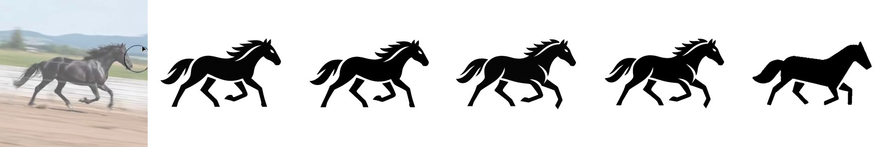

# quigs-logo-model — מערכת: תמונה של חיה נכנסת, לוגו גיאומטרי יוצא

**המטרה:** תמונה → לוגו בסגנון הסרטונים (`quigs-32`) → SVG + כרטיס ממותג → (שלב הבא) סרטון תהליך → פוסט יומי.

## המערכת (שלב 1, עובד היום)

```bash
pip install pillow numpy scipy potracer openai      # או google-genai ל-gemini
export OPENAI_API_KEY=sk-...
python3 scripts/photo_to_logo.py my_horse.jpg --name "Stallion" --bg "#11393c" --fg "#ffffff"
```

הפלט ב-`out/my-horse/`: `v0_raw.png` (מה שהמודל צייר), `v0.png` (לוגו נקי שחור על לבן),
`v0.svg` (וקטור לעריכה באילוסטרייטור), `v0_card.png` (הכרטיס הממותג), `meta.json`.

איך זה עובד: התמונה + 4 לוגואים מהדאטהסט כרפרנס סגנון נשלחים למודל עריכת תמונות
(`gpt-image-1`, או Gemini עם `--backend gemini`), עם פרומפט שמגדיר את הסגנון (סילואטה שטוחה אחת,
צורות גיאומטריות, חיתוכי negative space, בלי קווים/צללים/טקסט). הרסטר שחוזר עובר את אותו ניקוי
שבנה את הדאטהסט (`logo_post.py`: סף → פתיחה מורפולוגית → סינון רכיבים → potrace) ויוצא SVG.

**הדגמה על סוס (חיה שלא בסט האימון), `examples/horse/`** — משמאל לימין: תמונת הקלט, פלט גולמי,
לוגו נקי, וריאציה שנייה, ובקצה הלוגו המקורי מהסרטון להשוואה:



עלות: כחצי קרדיט/‑$0.04 לווריאציה. ההדגמה נעשתה דרך Higgsfield (אותו מודל); הקוד ב-`photo_to_logo.py`
קורא ל-OpenAI/Gemini ישירות ועדיין לא הורץ מול מפתח אמיתי – אם משהו נשבר שם זה יהיה בחתימת ה-API, לא בלוגיקה.

### שלב 1ב: מודל משלנו (תמונה→לוגו, דורש GPU)

הדאטהסט מכיל זוגות מיושרים `dataset/control/<stem>.png` (חיתוך התמונה סביב החיה) ↔ `dataset/logos/<stem>.png`.
`train/kontext_lora.yaml` מאמן LoRA על **FLUX.1 Kontext [dev]** (מודל עריכת תמונות) שלומד בדיוק את
ההמרה הזאת מ-27 הזוגות (54 עם שיקוף). זה יתן תוצאות קרובות יותר לסגנון הגולמי של הסרטונים
(פחות "אייקון סטוק", יותר חיתוכים גסים) ובלי תלות ב-API.

```bash
python3 scripts/prepare_training_data.py --dataset dataset --out train_data --mirror --kontext
cp train/kontext_lora.yaml <ai-toolkit>/train/ && cd <ai-toolkit> && python run.py train/kontext_lora.yaml
python3 scripts/photo_to_logo.py my_horse.jpg --backend kontext --lora output/quigs_kontext_lora/quigs_kontext_lora.safetensors
```

הדגימות במהלך האימון רצות על תמונות ה-holdout (סוס, שועל, דוב) – השוואה ישירה ל-`dataset/logos/`.

## הסרטון (שלב 2, עובד)

```bash
python3 scripts/make_video.py --photo bg_9x16.png --logo out/lion/v0.png --animal-mask cutout.png \
    --name "Maneo" --bg "#2b1a10" --fg "#f0b24a" -o lion.mp4
```

**לוגו שנבנה מעיגולים וקווים על החיה עצמה** (`silhouette_logo.py` + `construct.py`):

1. `prepare`: ה-cutout של החיה מנוקה לצללית אחת (פרווה, חורים).
2. המודל מקבל את הצללית ומוסיף רק חיתוכים פנימיים (עין, רעמה).
2ב. **הפשטה (`abstraction.py`, `combine --abstract`)**: לעקוב אחרי הצללית לא נותן את הסגנון של המעצב, כי הוא מצייר את החיה מחדש
   (גב כקו אחד, זנב כצורה אחת, רגליים מופרדות). את ההחלטה הזאת מקבל מודל תמונה שרואה זוגות צילום -> לוגו של המעצב עצמו
   ואת החיה החדשה, ומצייר אותה באותה תנוחה. הציור מוצמד לחיה, נבדקת החפיפה איתה, ואז הוא נבנה מחדש מצורות מושלמות כמו שהוא.
3. `combine`: קו המתאר נבנה מחדש כ**שרשרת הזולה ביותר של צורות מושלמות** (קו ישר, קשת של עיגול אמיתי, קשת של אליפסה).
   תכנון דינמי על כל ההיקף בוחר את החלוקה; הסטייה המותרת תלויה בעובי המקומי של החיה; הפינות הן נקודות החיתוך בין הצורות.
   הפרמטרים מאומנים על 32 סרטוני המקור (`train_on_references.py`), והתוצאות ב-`dataset/style_study.md`.
   קווי הבנייה בסרטון הם בדיוק העיגולים והקווים שהקשתות האלה שייכות אליהם, והמתאר האדום רץ עליהם.
4. `logo.svg` מכיל רק פקודות קשת וקו, לא trace של פיקסלים.
5. **איחוד ומחיקה כמו ב-Shape Builder:** לכל קשת וקו יש צורת בנייה (עיגול מלא או קו מוארך), כך שהצורות מחלקות את
   המישור לאזורים והלוגו הוא בדיוק איחוד האזורים שבתוך החיה. `merge_plan` מחשב את האזורים ואת סדר המעבר עליהם.
   בסרטון: סימון הכול → האזורים מתאחדים אחד-אחד (מילוי מנוקד, מתאר אדום שגדל) → האיחוד נהיה שחור →
   כל חיתוך מסומן ונמחק → שאריות קווי הבנייה מסומנות ונמחקות.

**צורות קודם, כמו במקור** (`dataset/style_study.md` מסכם מה נלמד מ-32 הסרטונים): קודם נבחרים גושי הגוף כעיגולים
ואליפסות שיושבים בתוך החיה, ורק אחר כך קווים ישרים קצרים לכל השאר וקו קרקע. `scripts/study_references.py`
מחלץ מכל סרטון מקור את השלבים ואת פריים הבנייה המלא.

**גרסה קודמת של הבנאי (עדיין בקוד, `shapes_first=False`):** קשת עדינה הופכת לקו ישר; כמה קטעים של קו המתאר יכולים לשבת על אותו עיגול או אותה
אליפסה (`consolidate`, עם בדיקה שהקשת המצוירת נשארת על הקטע שלה); והתקציב נמדד במספר הצורות העגולות
(`--max-ovals`, ברירת מחדל 14 לגוף), כי הן אלה שמעמיסות על הפריים וקווים לא.

**כיול מהמקור:** `construct.py calibrate` מתאים את אותו בנאי ל-32 הלוגואים המקוריים ושומר ב-`dataset/style_stats.json`
כמה "צפופה" הבנייה שלהם (חציון 42 פרימיטיבים ללוגו, 10.5 לכל 1000px של קו מתאר, 30% קווים ישרים).
בבנייה של חיה חדשה נבחרת הסבילות ההדוקה ביותר שעדיין עומדת בתקציב הזה.

**ביקורת מדודה:** כל בנייה מדפיסה חפיפה (IoU) וסטיית קו המתאר מהחיה בפיקסלים, ושומרת `critique.png`
(אדום: הלוגו חורג מהחיה, כחול: חלק מהחיה שלא כוסה). באריה: IoU 0.957, סטייה ממוצעת 1.7px, מקסימום 5px.

```bash
# צילום סטודיו על רקע אחיד: אין צורך ב-outpaint, רק מיקום על קנבס 9:16
python3 scripts/frame_photo.py --photo upscaled.png --cutout cutout.png --out work/   # -> work/bg.png, work/cutout.png
# צילום עם סצנה: --extend ממלא מעל ומתחת בהמשך מטושטש של התמונה עצמה, בלי outpaint גנרטיבי
# (outpaint גנרטיבי לגובה החליף פעם אחת את הציפור בציפור אחרת; כך החיה נשארת כמו שצולמה)
python3 scripts/frame_photo.py --photo photo.png --cutout cutout.png --out work/ --extend
python3 scripts/silhouette_logo.py prepare --photo bg.png --cutout cutout.png --out work/
# שלב ההפשטה: החיה חתוכה על לבן + שני דפי דוגמה של המעצב (צילום -> לוגו) -> מודל התמונה מצייר את ההפשטה בסגנון שלו
python3 scripts/abstraction.py input --photo bg.png --cutout cutout.png --out work/cutout_sq.jpg
# מודל תמונה (gpt_image_2_6, 1:1): dataset/abstraction/sheet_a.png, sheet_b.png, sheet_c.png, work/cutout_sq.jpg + dataset/abstraction/prompt.txt -> v0.png, v1.png
# עיניים: מודל התמונה צובע את העין האמיתית במג'נטה (הפרומפט בראש locate_eyes.py), והסקריפט מוציא מיקום, גודל וצורה
python3 scripts/locate_eyes.py --photo bg.png --cutout cutout.png --annotated marked.png --out work/eyes.json
python3 scripts/silhouette_logo.py combine --abstract --work work/ --model-output v0.png v1.png --eyes work/eyes.json
#   בוחר את הגרסה שיושבת הכי טוב על החיה, עם משקל כפול לאזור הראש; הבנייה מעיגולים וקווים בלבד (בלי אליפסות).
#   הציור הוא העיצוב, והבנייה נאמנה לו: קו המתאר סוטה ממנו לכל היותר 0.3% מגודל החיה, עיגול לא גדול מהגדול ביותר
#   של המעצב (0.37 מגודל החיה), וקצה ישר נשאר קו (מחיר קשת 1.5, הערך שנלמד מהסרטונים שלו). הגדרות רפויות יותר
#   (0.5%, עיגול עד 0.25, העדפת עיגולים) הפכו קשתות לשבורות ורגליים לכתמים: examples/designed_prompt_test.jpg.
#   העין נשארת במקום שבו הציור שם אותה (הראש בציור לא תמיד יושב בדיוק על הראש בצילום) ומקבלת את הצורה מהצילום
#   (עיגול, או לעין מוארכת העדשה שבין שני עיגולים); רק ציור בלי עין מקבל עין במקום של העין בצילום.
#   logo_sharp.svg = הלוגו הווקטורי כפי שנבנה: קשתות וקווים בלבד.
#   logo.svg/png = אותו וקטור אחרי השלב האחרון, עיגול פינות וקטורי (--corner-radius, ברירת מחדל 3px ללוגו ברוחב 512px; 0 מבטל).
#   כל פינה מוחלפת בעקומה קצרה בין שתי נקודות על הקטעים השכנים, כך ששום פרט לא נמחק; ליד קטע קצר הרדיוס קטן מעצמו.
python3 scripts/make_video.py --photo bg.png --construction work/construction.json --name "Maneo" -o lion.mp4
```

- `--photo`: התמונה אחרי הרחבה ל-9:16 (outpaint). כל גודל, נחתך ל-1080×1920.
- `--animal-mask`: cutout של החיה (הסרת רקע) באותו פריים. הלוגו מוזז ומוקטן אוטומטית כך שיכסה את החיה (מקסימום חפיפה).
- קווי הבנייה נגזרים מהלוגו עצמו: עיגולים חסומים לגושי הגוף, קווים מוארכים לאורך הקצוות הישרים, עיגולים שמותאמים לקשתות.
- הרינדור: `video/template.html` פריים-פריים ב-Playwright → ffmpeg (h264, 30fps, ערוץ שמע שקט). כ-35 שניות לסרטון של 20 שניות.
- דורש Node עם `playwright` ו-`ffmpeg`. דוגמת לוגו: `examples/lion/`.

### כרטיס המותג (`learn_brand_card.py` → `dataset/learned_card.json`, מיושם ב-`make_video.py: card_layout`)

נמדד על 28 מתוך 32 כרטיסי המותג של המעצב, ביחידות של גובה האות הגדולה (cap):

- גודל הכיתוב **קבוע**: גובה האות הגדולה 8.4% מרוחב הפריים (רבעונים 8.2% עד 8.6%). הוא לא משתנה לפי גודל הסמל.
- פונט בסגנון הלווטיקה מודגש (כאן TeX Gyre Heros Bold, חופשי, `video/fonts/`), ריווח אותיות צפוף: כ‑0.077em פחות מהרגיל (נמדד על ארבעה שמות).
- הסימן הוא **©** (לא ®), במשקל רגיל: קוטר 0.58 cap, המרכז שלו 0.95 cap מעל קו הבסיס, ורווח של 0.07 cap מהאות האחרונה.
- רווח בין תחתית הסמל לראש האותיות: 0.74 cap. הסמל והשם יחד ממורכזים בפריים (אנכית 49%, אופקית 49%).
- רוחב הסמל: חציון 61% מרוחב הפריים; חיה גבוהה מוגבלת לגובה של 33% מהפריים.

השוואה: `examples/brand_cards_vs_designer.jpg` (ארבעה כרטיסים שלו, ארבעה שלנו).

## הרואדמפ

| שלב | מה | סטטוס |
|---|---|---|
| 1 | תמונה → לוגו (API) | ✅ עובד, `photo_to_logo.py` |
| 1ב | תמונה → לוגו (LoRA משלנו על Kontext) | מוכן לאימון, צריך GPU |
| 1ג | לוגו מטקסט בלבד (LoRA על FLUX) | מוכן לאימון, `train/flux_lora.yaml` |
| 2 | סרטון תהליך 9:16 (תמונה → קווי בנייה → מתאר אדום → סילואטה → כרטיס לבן → כרטיס ממותג) | ✅ עובד, `make_video.py` |
| 3 | פוסט יומי אוטומטי (תור חיות, רינדור, העלאה) | אחרי 2 |
| 4 | מכירה: SVG + כרטיס + קבצי מותג בחבילה | אחרי 3 |

---

# מבנה ודאטה

הלוגואים: סילואטה שחורה, גיאומטרית, מינימליסטית, עם חיתוכי negative space, על רקע אחיד, ובסוף כרטיס ממותג עם שם + ®.

```
quigs-logo-model/
├── dataset/                 הדאטה שחולץ אוטומטית מ-32 הסרטונים
│   ├── logos/               32 לוגואים נקיים, שחור על לבן, 1024×1024 (תמונות האימון)
│   ├── svg/                 אותם לוגואים כווקטור (potrace)
│   ├── captions/            כיתוב לכל תמונה (trigger word: QUIGS)
│   ├── pairs/               תמונה מקורית → סילואטה על התמונה → כרטיס → כרטיס ממותג (מוקטן)
│   ├── control/             חיתוך התמונה סביב החיה, מיושר ללוגו (קלט לאימון תמונה→לוגו)
│   ├── palette.json         צבע רקע + צבע לוגו של כל כרטיס ממותג בסרטונים
│   ├── manifest.json        מטא-דאטה: split (train/holdout), זמני הפריימים, bbox
│   └── preview/             contact sheets לבדיקה בעין
├── captions.json            הכיתובים (אפשר לערוך ולהריץ שוב)
├── scripts/
│   ├── photo_to_logo.py     ★ המערכת: תמונה → לוגו PNG+SVG+כרטיס (openai / gemini / kontext)
│   ├── extract_dataset.py   סרטונים → dataset/ (זיהוי אוטומטי של שלבי הסרטון)
│   ├── build_control_pairs.py  פריימי overlay → dataset/control/ מיושר ללוגואים
│   ├── prepare_training_data.py  dataset/ → תיקיית אימון (+ שיקוף אופציונלי)
│   ├── silhouette_logo.py   ★ cutout של החיה + חיתוכי המודל → לוגו שיושב על החיה
│   ├── construct.py         ★ בונה את קו המתאר מקשתות וקווים, מכייל מהמקור, מודד סטייה
│   ├── make_video.py        ★ תמונה + בנייה → סרטון תהליך 9:16 (render_video.cjs + video/template.html)
│   ├── generate.py          FLUX + LoRA → לוגו נקי + SVG (+ כרטיס)
│   ├── logo_post.py         ניקוי רסטר → מסכה → SVG
│   └── make_card.py         לוגו + שם + צבעים → הכרטיס הממותג מסוף הסרטון
└── train/
    ├── kontext_lora.yaml    קונפיג ai-toolkit ל-LoRA תמונה→לוגו על FLUX.1 Kontext
    ├── flux_lora.yaml       קונפיג ai-toolkit ל-LoRA טקסט→לוגו על FLUX.1-dev
    └── run_cloud.sh         סקריפט אימון מלא למכונת GPU בענן
```

## מה כבר נעשה (רץ בלי GPU)

1. **חילוץ הדאטה** – כל סרטון עובר אותו תסריט: תמונה → עיגולים וקווי בנייה → קו מתאר אדום →
   סילואטה שחורה על התמונה → לוגו על כרטיס אחיד → כרטיס עם שם המותג.
   הסקריפט מזהה את הפריימים "השטוחים" (רקע אחיד) בסוף הסרטון, שולף את הכרטיס הראשון בלי טקסט,
   מנקה קווי עזר ושאריות טקסט (רכיבים מחוברים + morphology), ומנרמל לשחור-על-לבן מרובע.
2. **וקטוריזציה** – כל לוגו עבר potrace ל-SVG, וזה אותו מסלול שהפלט של המודל יעבור.
3. **כיתובים** – 32 כיתובים ידניים עם trigger word `QUIGS`, תנוחה/זווית לכל חיה.
4. **פיצול** – 27 לאימון, 5 holdout (fox, horse, serval, gazelle, bear) שאף פעם לא נכנסים לאימון,
   כדי שאפשר יהיה להשוות "המודל נגד המקור" על חיות שהוא לא ראה.
5. **כרטיס ממותג** – `make_card.py` משחזר את הכרטיס מסוף הסרטון (נבדק על הדוב והעיט).

## אימון (דורש GPU עם 24GB+)

הגישה: **style LoRA על FLUX.1-dev** עם [ai-toolkit](https://github.com/ostris/ai-toolkit).
27 תמונות (54 עם שיקוף) מספיקות ל-LoRA סגנוני; 2000 צעדים, rank 16, lr 1e-4, דגימות כל 250 צעדים.

על מכונה בענן (RunPod / Lambda / Vast / Higgsfield rental), עם H100 זה ~45 דקות, L40S ~1.5 שעות:

```bash
# פעם אחת: לאשר את רישיון FLUX.1-dev ב-huggingface.co/black-forest-labs/FLUX.1-dev
export HF_TOKEN=hf_...
git clone <repo> && bash buno/quigs-logo-model/train/run_cloud.sh buno/quigs-logo-model
```

הסקריפט משכפל את ai-toolkit, בונה `train_data/` מ-`dataset/` (train בלבד), ומריץ את
`train/flux_lora.yaml`. ה-LoRA נשמר ב-`output/quigs_logo_flux_lora/*.safetensors`,
ודגימות ביניים (סוס, שועל, דוב, ינשוף) ב-`output/.../samples/`.

ידנית, אם כבר יש ai-toolkit מותקן:

```bash
python3 scripts/prepare_training_data.py --dataset dataset --out /path/ai-toolkit/train_data --mirror
cp train/flux_lora.yaml /path/ai-toolkit/train/
cd /path/ai-toolkit && python run.py train/flux_lora.yaml
```

### איך יודעים שזה עובד

```bash
python3 scripts/generate.py --lora output/quigs_logo_flux_lora/quigs_logo_flux_lora.safetensors --holdout
```

מייצר את 5 חיות ה-holdout ובונה `out/holdout_sheet.png`: עמודה שמאלית = הלוגו האמיתי מהסרטון,
לידו 4 וריאציות של המודל. אם ה-LoRA "מצייר" סילואטות שטוחות עם חיתוכי negative space ולא
איורים מצוללים – הסגנון נתפס. אם הוא משחזר כמעט בדיוק את חיות האימון – overfit, לקחת checkpoint מוקדם יותר (1250–1500).

## שימוש (אחרי האימון)

```bash
python3 scripts/generate.py --lora quigs_logo_flux_lora.safetensors "an owl perched in side profile" --n 4
python3 scripts/generate.py --lora ... "a wolf howling in side profile" --name "Howlr" --bg "#07142f" --fg "#dceffb"
```

לכל תוצאה: `out/<slug>_<seed>.png` (שחור על לבן נקי), `.svg` (וקטור), ו-`_card.png` אם ניתן שם.
צבעי מותג לדוגמה נמצאים ב-`dataset/palette.json` (32 זוגות רקע/לוגו מהסרטונים).

## הערות

- הפלט של המודל הוא רסטר; `logo_post.py` מנקה אותו (סף, פתיחה מורפולוגית, סינון רכיבים) ומוקטר ל-SVG,
  כך שהתוצאה הסופית ניתנת לעריכה באילוסטרייטור כמו המקור.
- הסרטונים עצמם לא ב-repo (60MB). להרצת החילוץ מחדש:
  `python3 -I scripts/extract_dataset.py <dir-with-mp4s> --out dataset --captions captions.json`
- הלוגואים בסרטונים הם עבודה של מעצב/ת אחר/ת. אימון על סגנון הוא בסדר מבחינה טכנית, אבל
  שימוש מסחרי בלוגואים שנראים קרובים מדי למקוריים (למשל אותו דוב) – כדאי להימנע ממנו.
- אלטרנטיבה בלי אימון: אותם כיתובים + 3–4 לוגואים מ-`dataset/logos` כרפרנס במודל תמונה מסחרי
  (gpt-image / Nano Banana) נותנים תוצאה סבירה, ו-`logo_post.py` מנקה אותה לאותו פורמט.
